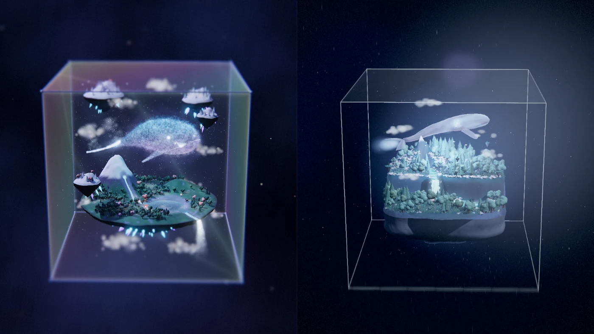

# 玻璃立方体云鲸 · 双版分屏对照

> Glass Cube Cloud Whale · Side by Side

两个独立编写的 WebGL 场景并排渲染，共用一套相机。同一个"被封存在玻璃里的微型宇宙"主题，两种完全不同的实现路径——拖拽、缩放、翻面实时同步，方便同角度比对。



左：初版（星尘云鲸、发光浮岛、程序化地形）
右：重写版（参数化躯干云鲸、半透明琉璃材质、极坐标地形）

---

## 快速开始

```bash
npm install     # 装 three / esbuild / puppeteer-core，并自动生成 vendor/
npm start       # 起服务器，等同于 python serve.py 5173
```

打开 **http://127.0.0.1:5173/host/index.html**

局域网访问（手机、平板、另一台电脑）：

```bash
npm run serve:lan    # 绑定 0.0.0.0，终端会打印本机 IP
```

必须走 http——两个 iframe 加载 ES module，`file://` 会被 CORS 拦。

> 不用 npm 也能跑，只需三样：`left/` 与 `right/` 目录、`vendor/`（从 `node_modules/three` 复制 `build/` 和 `examples/`）、一个**多线程**静态服务器。单线程的 `python -m http.server` 会因并行加载 25 MB 模块而失败，`serve.py` 已经处理了这点。

## 操作

| 输入 | 效果 |
| --- | --- |
| 拖拽任一侧 | 环绕旋转，两侧同时转 |
| 滚轮 / 双指 | 缩放，k ∈ [0.85, 9.6] |
| `1` / `2` / `0` | 只看左边 / 只看右边 / 恢复双屏 |
| 空闲 4.5 秒 | 恢复自动巡航 |

鼠标在哪半边都生效：宿主捕获整个舞台的指针事件，转发给两侧。画面上没有任何文字或按钮。

## 同步是怎么做到的

两个场景的物理尺度差 **8.7 倍**（立方体半边 5 vs 0.745 单位），fov 也不同（28° vs 26°）。直接同步相机距离没有意义，所以统一到归一化坐标：

- **yaw / pitch** — 绝对弧度，两侧完全一致
- **k** — 相机距离 ÷ 立方体半对角线

每个子场景把 k 换算成自己的世界距离，并做 fov 补偿，让立方体在屏幕上投影等大：

```
dist = halfDiag × k × tan(27°) / tan(fov/2)
```

27° 是两侧共用的参考 fov。没有这一步，fov 大的那一侧画面会明显更广，比对就失去意义。

### 子页面接口

两侧都暴露 `window.__view`，宿主每次输入调用一次：

```js
{
  side: 'left' | 'right',
  fov, halfDiag, camera,
  apply(yaw, pitch, k)
}
```

`?embed=1` 打开时的行为：

- **左**：`controls.enabled = false`，关阻尼、关自动旋转，并且**不再调用** `controls.update()`——它的 `minDistance/maxDistance` 钳制会覆盖宿主推来的值
- **右**：`canvas.style.pointerEvents = 'none'`，开场运镜短路，世界浮动冻结

## 已知差异（不是 bug）

- **内容占满率不同。** 左屏岛小鲸鱼大、画面填得满；右屏岛占底部三分之一，上方留给云鲸。立方体外框等大，内部构图是各自的设计选择。
- **同一角度框到不同内容。** 转到某些角度左边看雪山、右边看森林。同步的是相机，不是画面内容。
- **pitch 差 0.004 rad。** 两侧 lookAt 目标点不同（左 `(0,-0.2,0)`，右 `(0,0.03,0)`），反推角度有极小偏差。
- **右屏玻璃几乎不可见。** 原设计就是"克制到近乎透明的玻璃"，未做增强。

## 结构

```
glass-whale-side-by-side/
  host/index.html            双 iframe 宿主 + 相机状态 + 输入 + 自动巡航
  left/                      左屏（index.html + main.js，原生 ES module）
  right/scene.html           右屏打包产物（单文件，开箱即用）
  right/src/                 右屏源码（十一个模块）
  right/build.mjs            esbuild 打包脚本
  scripts/vendor-three.mjs   从 node_modules 生成 vendor/
  serve.py                   多线程静态服务器
  verify.mjs                 交互断言脚本
  vendor/                    不提交，npm install 时生成
```

## 开发

```bash
npm run build:right    # 改完 right/src/ 后重新打包
npm run vendor         # 重建 vendor/
npm run verify         # 交互断言（需要服务器在跑）
```

左屏是原生 ES module，改 `left/main.js` 直接生效（服务器已禁用缓存）。

`verify.mjs` 用 puppeteer 断言而不是看图：两侧接口存在、几何尺寸正确、初始 k 一致、左侧拖拽后两侧 k 仍一致、滚轮缩放、上下限钳制、pitch 可低于水平面、右侧拖拽同样生效、`1` 键隐藏右屏、自动巡航恢复。Chrome 路径自动探测，可用 `CHROME_PATH` 覆盖。

## 依赖

| 包 | 用途 |
| --- | --- |
| `three` 0.170 | 两侧场景的渲染库 |
| `esbuild` | 打包右屏单文件产物 |
| `puppeteer-core` | `verify.mjs` 的无头验证（可选） |

`vendor/` 不进仓库：25 MB 的 three 构建产物由 `scripts/vendor-three.mjs` 从 `node_modules` 现场复制，`npm install` 后自动执行。

---

# 设计提示词

以下是驱动这两个场景的完整需求描述，保留原文以便复现或改造。

## 总述

一个超精细、收藏级的 3D 微缩梦幻生态场景：一个透明玻璃立方体悬浮在深邃安静的宇宙空间中，像一件高端桌面艺术摆件。立方体内部封存着一个独立的小宇宙生态系统，充满魔法现实主义与空灵梦境感。

画面核心主体是一头受 DeepSeek 云鲸启发重新设计的半透明"云鲸星灵"，不是平面 logo，而是一只立体的梦境生命体，具有鲸鱼的优雅轮廓、云朵般柔软的体积感、温柔智慧而宁静神秘的气质。它的身体由云雾、星尘、薄光与半透明体积构成，内部可见发光心核、缓慢流动的星轨、微弱光脉冲和细腻粒子，游动时尾部拖曳云絮、薄雾与星光粒子轨迹。

围绕它分布着精致的微缩生态：漂浮的小型雪山岛屿、柔和起伏的草地、lush 森林、蜿蜒发光河流、平静清透的小湖泊、液态星光般的小瀑布、微型动物、漂浮云朵与薄雾。

整个生态会随着云鲸的呼吸产生轻微律动，湖面出现微弱波纹，雾气轻轻流动，植物高光轻微起伏，局部环境光柔和脉动。

玻璃立方体边缘极薄而通透，具有真实折射、细腻高光和克制的彩虹微光，既让人清楚感知这是一件被封存的空间容器，又不会遮挡内部景观。

背景为深蓝黑色和冷紫黑色的模糊宇宙空间，只有少量星点与轻微星云，不喧宾夺主。

整体构图采用等距视角基础、略带透视、微距摄影感、移轴效果、浅景深和电影级体积光。灯光包括柔和环境光、晨曦与月光交融的昼夜过渡光、轻微轮廓光和穿过薄雾的体积光束。

整体色调以深蓝、薰衣草紫、月光银、青蓝微光为主，辅以极少量珊瑚粉点缀。材质结合精致黏土微景观感、半透明琉璃感和高级艺术摆件质感。

画面必须梦幻、宁静、空灵、神秘、高级、超高细节，像一个真实存在但又不可思议的微型宇宙。

## 场景目标

不是普通 3D 自然场景，而是收藏级艺术摆件风格的梦境微型宇宙。整体视觉结合：微缩生态景观、桌面摆件、半透明梦幻材质、魔法现实主义、电影级氛围光、安静空灵治愈的气质。

## 核心主体：云鲸星灵

1. 立方体内部创建一头缓慢游动的云鲸星灵。
2. 不是写实鲸鱼，而是受 DeepSeek 云鲸启发的 3D 梦境生命体。
3. **形体**：保留鲸鱼轮廓；带云感和漂浮感；姿态舒展优雅；体积柔和，不尖锐、不具攻击性。
4. **材质**：半透明；带体积感；带柔和自发光；内部有缓慢流动的光纹；内部可见发光核心或星轨结构。
5. **动画**：缓慢摆尾；轻柔上下起伏；游动路径平缓；尾部生成粒子尾迹、云雾尾迹和星尘流线；运动节奏平静、治愈，不快。

## 微缩生态内容

- 小型雪山 / 山体
- 草地与地形起伏
- 微缩森林
- 小湖泊
- 一条蜿蜒河流
- 一处小型瀑布
- 少量漂浮小岛
- 漂浮云朵
- 轻薄雾气
- 少量极小型动物或灵性生命点缀

**生态风格**：精致；干净；有模型感；不要粗糙写实地形扫描感；不要过度堆叠元素；要有主次关系和呼吸感。

## 联动设计

- 云鲸呼吸时，内部核心光缓慢明暗变化
- 湖面产生细微波纹
- 河流边缘光轻微脉动
- 雾气缓慢偏移
- 周围粒子轻微响应云鲸运动
- 场景整体环境光可做轻柔起伏
- 可加入非常缓慢的昼夜光感过渡

## 玻璃立方体

1. 使用清透玻璃材质构建方形容器。
2. 要求：边缘折射；柔和高光；轻微反射；极弱虹彩边缘。
3. 玻璃不能太厚重，也不要太假。
4. 立方体应像高端展柜外壳或艺术摆件保护罩。

## 背景与外部空间

1. 背景使用深色宇宙环境。
2. 只保留少量星点和极弱星云层。
3. 背景做虚化与弱存在感，避免喧宾夺主。
4. 强调"玻璃立方体漂浮在深空中"的孤独感和神秘感。

## 相机与构图

1. 默认构图采用等距偏透视的产品展示视角。
2. 镜头略高位，能同时看到立方体前面、侧面与顶部一点。
3. 整体要有微距摄影感和轻微移轴效果。
4. 适度使用景深，让主体突出。
5. 云鲸位于视觉中心偏上，湖泊与地形位于中下部，形成层次。

## 灯光与后处理

1. 柔和环境光作为基础。
2. 加入晨曦与月光交融的内部氛围光。
3. 使用轮廓光突出云鲸和立方体边缘。
4. 使用轻微体积光和 bloom。
5. 适度使用景深 DOF。
6. 不要过度炫技，不要赛博夜店灯效。

## 色彩系统

**主色调**：深蓝、午夜蓝、薰衣草紫、月光银、青蓝微光。
**辅色**：冰白、雾白、淡青绿、极少量珊瑚粉。
整体色彩要求克制、高级、柔和，不可过艳。

## 交互要求

- 支持鼠标拖拽旋转观察
- 支持滚轮缩放
- 支持轻微自动旋转
- 鼠标移动时可轻微影响粒子和雾气
- 不要复杂 UI
- 不要出现文字、按钮、控制面板

## 技术目标

- 优先保证视觉完成度
- 场景尽量程序化构建
- 减少对复杂外部模型依赖
- 代码结构清晰
- 动画平稳
- 支持现代浏览器运行
- 视觉偏艺术展示页，而不是游戏任务场景

## 最终效果

像一个漂浮在宇宙中的高级梦境标本：立方体像容器，云鲸像灵魂，生态像被赋予呼吸的微型世界。

## 负面提示词

> 不要普通写实海洋场景，不要真实海底，不要普通鲸鱼摄影，不要扁平品牌 logo，不要机械科幻飞船，不要赛博朋克城市，不要儿童卡通风，不要低幼玩具风，不要粗糙 low poly，不要杂乱堆砌元素，不要高饱和彩虹乱色，不要恐怖氛围，不要灾难感烟雾，不要厚重塑料盒感，不要商场展示柜感，不要文字，不要 UI，不要水印，不要过度对称，不要过曝，不要廉价霓虹灯感，不要过强商业广告感。

---

## 许可

MIT
